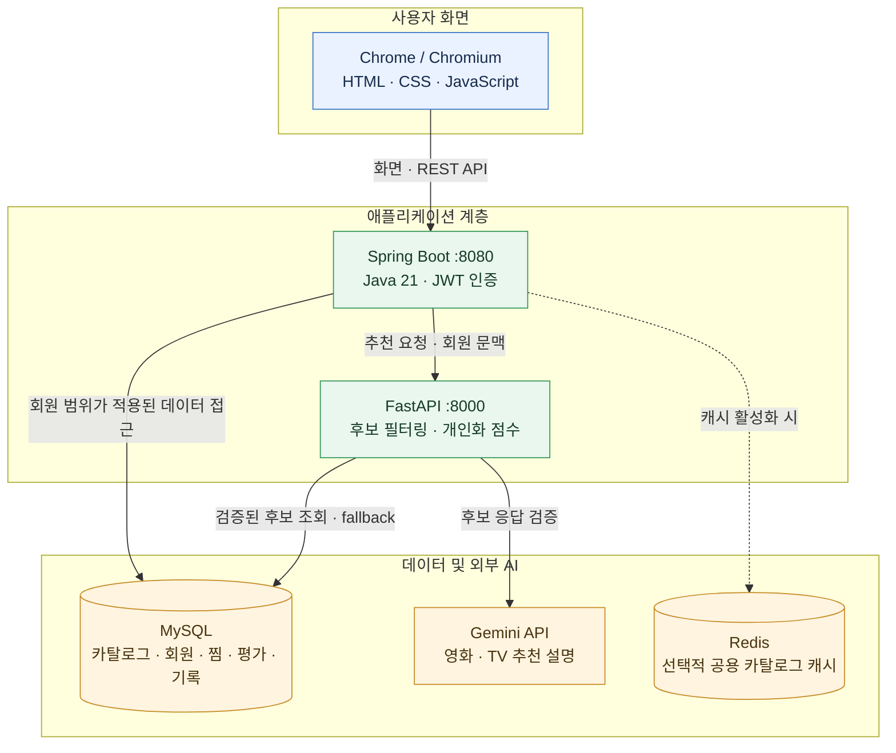

# AI CONTENT LAB

### 취향을 읽고, 근거 있는 작품을 연결하는 콘텐츠 추천 서비스

영화·드라마·웹툰을 검색하고 설문과 회원의 취향 신호를 조합해 추천하는 로컬 웹 애플리케이션입니다. **Spring Boot**가 웹/API와 회원별 데이터 접근을 담당하고 **FastAPI**가 추천 후보와 점수를 처리합니다. 외부 생성형 AI가 실패해도 영화·TV는 카탈로그 기반 로컬 추천으로 전환하며, 웹툰은 검증된 메타데이터를 이용한 결정적 점수 경로를 사용합니다.

## 핵심 구현 성과

| 영역 | 구현 내용 |
| --- | --- |
| 서비스 연동 | Spring Boot에서 인증된 추천 요청을 FastAPI로 전달하고 응답을 검증 |
| 회원 보안 | JWT 인증 주체로 회원 범위를 결정해 찜·평가·추천 기록을 분리 |
| 개인화 추천 | 현재 설문·제외 조건과 검증된 카탈로그 특징을 반영하고, 관련성이 낮은 작품으로 결과를 채우지 않음 |
| AI 장애 대응 | 영화·TV의 제한된 Gemini 장애에서 자체 카탈로그 추천으로 전환하고 출처를 응답에 표시 |

## 기술 스택

| 영역 | 기술 |
| --- | --- |
| 웹/API 및 보안 | Java 21, Spring Boot, Spring Security, Maven, JWT |
| 추천 서비스 | Python, FastAPI, Google Gen AI SDK |
| 데이터 | MySQL 8.x, 선택적 Redis 캐시 |
| 브라우저 | HTML, CSS, JavaScript |
| 테스트 | JUnit, Python unittest, Node 기반 브라우저/API 점검 스크립트 |

## 아키텍처



브라우저는 Spring API를 사용합니다. 회원 ID는 브라우저 요청값이 아니라 인증된 토큰에서 얻어 회원별 찜·평가·추천 기록 범위를 제한합니다. 콘텐츠를 구분할 때는 숫자 ID만 사용하지 않고 `(type, id)`를 함께 사용합니다. Redis는 선택 사항이며 기본적으로 비활성화되어 있습니다.

## 주요 기능

- 영화·드라마·웹툰 목록, 유형 필터, 검색, 상세 및 유사 작품 조회
- 비로그인 설문 추천과 로그인 회원 추천
- 회원가입·로그인·로그아웃, 프로필과 취향, 찜, 평가, 추천 기록
- 현재 설문과 제외 조건을 후보 필터·점수 계산에 반영
- Gemini 응답은 실제 카탈로그 후보의 ID와 유형을 대조하고 중복·범위 밖 결과를 거부
- Gemini의 일부 일시 장애에서는 영화·TV의 기존 카탈로그 후보와 점수로 로컬 fallback 제공
- 웹툰은 확인된 메타데이터로 점수와 추천 근거를 계산하며, 없는 표지는 대체 표지로 구분
- 대체 표지 및 외부 작품 링크의 출처 상태를 UI에 표시

추천 후보가 부족하면 존재하지 않는 작품으로 채우지 않습니다. 데이터의 출처·장르·표지 사용 권한이 확인되지 않은 경우 이를 실제 공식 정보인 것처럼 표현하지 않습니다.

## 검증 기록

아래 숫자는 저장소의 2026-11-25 포트폴리오/개발 검증 기록에서 발췌한 결과입니다. 이번 저장소 정비 요청에서는 전체 테스트를 다시 실행하지 않았으므로, 현재 이 checkout에서 새로 실행한 결과로 해석하면 안 됩니다.

| 검증 범위 | 기록된 결과 | 구분 및 한계 |
| --- | --- | --- |
| Java/Maven | 61건 실행, 실패 0, 오류 0, 건너뜀 9 | 선택형 Redis·MySQL·E2E·벤치마크 테스트는 별도 환경 필요 |
| Python | 60건 통과 | unittest 기록. 실제 외부 서비스 호출 전체를 뜻하지 않음 |
| 회원 통합 | 격리 QA 환경에서 인증, 회원별 데이터 분리, 찜·평가·이력 저장 및 복원 확인 | 합성 QA 계정 사용; 기존 회원 데이터에 대한 일반적인 운영 보증은 아님 |
| 브라우저 | Chrome/Chromium PC·모바일 화면 및 주요 사용자 흐름을 별도 검증 | 일부 화면/API 경로는 모의 제공자 또는 격리 QA 환경을 사용 |
| 실제 게스트 웹툰 API | UTF-8 요청으로 장르 설문 5종을 Spring→FastAPI→로컬 MySQL에 보내 결과 수·순위·점수 변화 확인 | 결과 수 3·1·5·5·5건. 후보 부족은 실제 응답 수로 유지하며 DB 쓰기와 Gemini 호출은 없음 |
| 실제 Gemini | 실DB 드라마 요청은 제한적으로 성공 기록이 있고, 영화 요청은 HTTP 503 기록이 있음 | Gemini 가용성은 외부 요인; 승인된 호출 이외의 호출·성공을 주장하지 않음 |
| 로컬 fallback | Gemini 장애를 주입한 격리 경로에서 카탈로그 작품 반환과 기록 흐름 확인 | fallback 결과이며 실제 Gemini 생성 결과가 아님 |

세부 API·데이터 모델과 검증 환경별 한계는 [포트폴리오 기술 개요](PORTFOLIO_TECHNICAL_OVERVIEW.md)에 정리했습니다.

## 로컬 실행

### 준비

- Java 21, 프로젝트 포함 Maven Wrapper
- Python 3.11 이상 권장 및 `requirements-container.txt`에 명시된 패키지
- 기존 MySQL 스키마와 데이터
- 로컬 개발용 환경 변수. `.env.example`은 변수 이름과 빈 예시만 제공하며 실제 키·비밀번호를 채운 뒤 Git에 추가하지 마세요.

의존성을 설치하고 `.env.example`을 참고해 **Git에 포함하지 않을** 로컬 `.env`를 준비합니다. Spring Boot는 Uvicorn의 `--env-file`을 자동으로 읽지 않으므로 `DB_PASSWORD`, `JWT_SECRET` 등 Spring 설정 변수는 Spring 프로세스 환경에도 별도로 주입해야 합니다. 기존 비밀값을 README나 셸 이력에 붙여넣지 마세요.

### FastAPI

프로젝트 루트에서:

```powershell
py -m pip install -r requirements-container.txt
py -m uvicorn ai_server:app --host 127.0.0.1 --port 8000 --env-file .env
```

### Spring Boot

별도 PowerShell에서:

```powershell
Set-Location contentlab
.\mvnw.cmd spring-boot:run
```

루트의 `start_servers.bat`은 로컬 개발 서버 시작 스크립트입니다. 환경의 Java, Python, MySQL 및 기존 비밀 변수 설정이 준비되어 있어야 합니다. 애플리케이션이 연결된 DB가 맞는지 확인한 뒤 사용하세요.

### 확인 주소

- 웹사이트: <http://127.0.0.1:8080/>
- Spring 상태: <http://127.0.0.1:8080/api/health>
- FastAPI 상태: <http://127.0.0.1:8000/health>
- FastAPI OpenAPI: <http://127.0.0.1:8000/docs>

회원 API와 내부 FastAPI API는 인증/네트워크 범위가 다릅니다. 로컬 포트나 내부 API를 임의로 외부에 공개하지 마세요.

## API 개요

| 영역 | 엔드포인트 예시 |
| --- | --- |
| 카탈로그 | `GET /api/contents`, `/api/contents/search`, `/api/contents/{type}/{id}` |
| 인증 | `POST /api/auth/register`, `/api/auth/login`, `/api/auth/logout` |
| 회원·취향 | `GET /api/me`, `/api/me/taste` 및 취향 하위 API |
| 찜 | `GET /api/favorites`, `POST/DELETE /api/favorites/{type}/{id}` |
| 추천·기록 | `POST /api/recommend`, `GET /api/history`, `DELETE /api/history/{id}` |
| FastAPI 내부 | `GET /health`, `POST /recommend` |

실제 컨트롤러와 요청/응답 모델을 기준으로 자세한 계약을 확인하세요. 회원 API의 세부 경로와 인증 규칙은 코드 및 [기술 개요](PORTFOLIO_TECHNICAL_OVERVIEW.md)에 정리되어 있습니다.

## 테스트 명령

프로젝트 루트:

```powershell
py -m unittest -v test_ai_server
```

`contentlab/` 디렉터리:

```powershell
.\mvnw.cmd test
```

격리된 DB, Redis, 브라우저 또는 실제 Gemini를 요구하는 선택형 테스트는 필요한 환경을 먼저 확인하세요. 실제 Gemini 테스트는 외부 호출이며 요금제에 따라 비용이 발생할 수 있습니다. 기본 테스트 실행이 실서비스 Gemini 호출을 의미하지는 않습니다.

## 문서

- [배포·환경 구성 안내](DEPLOYMENT.md)
- [포트폴리오 기술 개요](PORTFOLIO_TECHNICAL_OVERVIEW.md)
- [웹툰 데이터·통합 주의사항](KMAS_WEBTOON.md)

## 면접에서 설명할 수 있는 기술 문제

1. **회원 데이터 경계:** 브라우저가 보낸 회원 ID를 신뢰하지 않고 Spring 인증 주체에서 회원 ID를 가져와 조회·저장에 전달합니다.
2. **추천 결과 정합성:** Gemini가 반환한 후보를 DB 카탈로그와 대조하고, 실제 후보에 없는 작품·중복 결과를 제거합니다. UI 정렬은 표시 점수와 같은 기준을 따르도록 검증합니다.
3. **장애 대응:** Gemini의 명시적 일시 장애와 잘못된 응답을 구분하고, 허용된 장애 유형에서만 로컬 후보 점수 경로를 사용합니다. fallback 출처를 응답에 남겨 AI 생성 추천과 구별합니다.
4. **이종 콘텐츠 식별:** 영화·TV·웹툰 ID가 충돌할 수 있어 `(type, id)` 복합 식별을 사용하고 외부 공급자 ID는 내부 카탈로그 식별과 분리합니다.
5. **권리 미확인 미디어:** 공식 표지 권한을 확인하지 못한 작품은 원본 이미지를 재게시하지 않고 명시적인 로컬 대체 디자인을 보여줍니다.

### 학습 및 면접 준비

- 추천 API의 입력 DTO부터 Spring 인증 주체, FastAPI 요청, MySQL 후보, 응답 DTO, 브라우저 카드까지 한 요청을 추적해 보세요.
- `AiRecommendationClient`와 FastAPI 추천 경로의 타임아웃·상태 코드·fallback 경계를 설명하고, 어떤 장애는 fallback으로 처리하지 않는지 말할 수 있어야 합니다.
- `favorites`의 회원·유형·작품 복합 키가 재요청 중복과 콘텐츠 ID 충돌을 어떻게 막는지 설명해 보세요.
- **예상 질문:** Gemini 출력이 DB 작품에 없으면 어떻게 하나요? 영화 ID와 TV ID가 같으면 어떻게 구분하나요? 제외 조건과 개인화 점수의 우선순위는 무엇인가요? Redis 장애가 회원 데이터에 영향을 주지 않게 어떻게 분리했나요?

## 한계 및 데이터 출처

- 이 저장소는 로컬 개발·포트폴리오 프로젝트입니다. 공개 운영 배포, 모든 작품 데이터의 재배포 권한, 실제 Gemini의 지속 가용성을 보증하지 않습니다.
- 검증 기록의 로컬 MySQL 스냅샷에는 영화 591건, TV 603건, 웹툰 66건이 있었습니다. 당시 웹툰 61건은 네이버웹툰 데이터로, 나머지는 개발용 데이터로 구분됐습니다. 이는 특정 로컬 DB 시점의 수치이며 저장소를 받는 사용자의 DB에 같은 데이터가 있다는 뜻은 아닙니다.
- 2026-11-25 읽기 전용 집계에서 네이버웹툰 61건은 작가와 공식 작품 링크가 각각 61건, 장르가 55건에 있었습니다. 스토리·분위기·전개 태그는 0건, 별도 출처가 연결된 공식 태그 자료는 6건이었습니다. 모든 작품에 스토리·분위기 기반 추천 근거가 있는 것은 아닙니다.
- 작품·표지·설명의 공개 재배포 권한은 별도 확인이 필요합니다. 실제 표지를 복제해 포함하지 않고 로컬 대체 디자인을 사용합니다.
- `db/demo/`의 seed는 합성·개발 데이터입니다. 실제 카탈로그로 오인하지 마세요. `db/migrations/`는 기존 DB에 자동 적용되지 않습니다.
